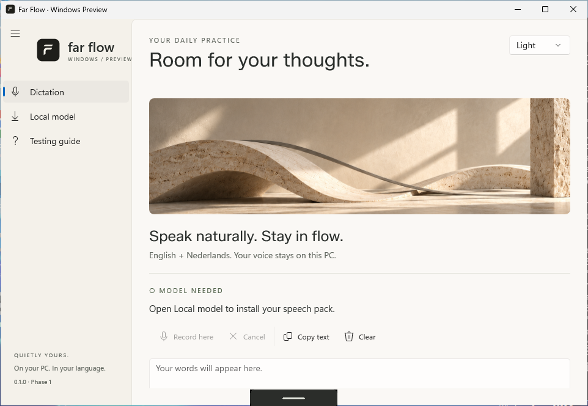
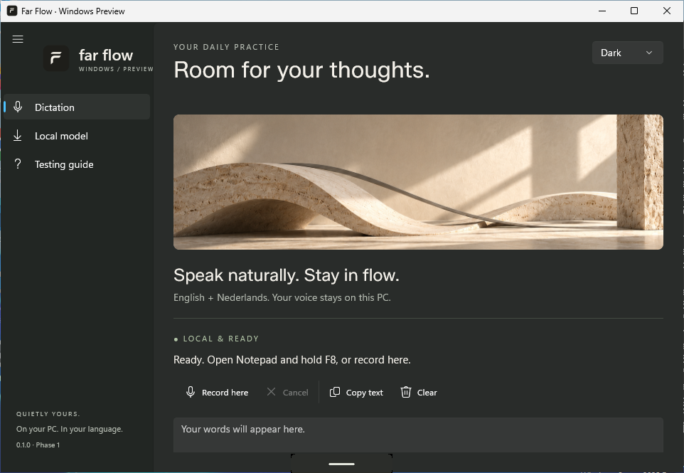
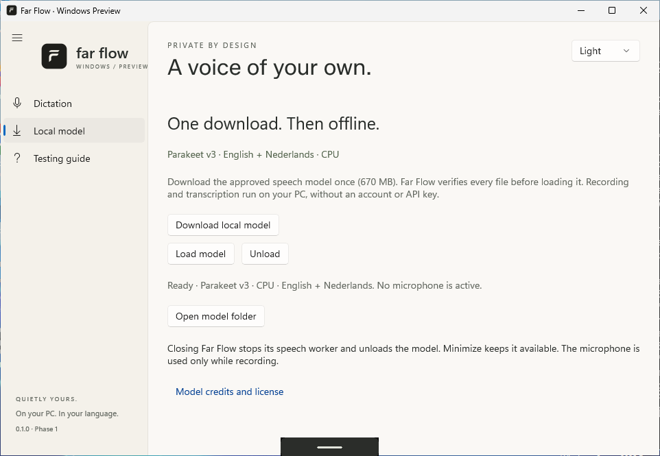

<h1 align="center">Far Flow for Windows</h1>

<strong>Your voice. On your PC.</strong> Private English and Dutch dictation, in a quiet native Windows app.

  

Actual Windows app capture. The approved Far Flow logo and travertine artwork are rendered inside the native interface.

**Phase 1 evaluation preview.** This is the independent Windows edition of [Far Flow for Mac](https://github.com/Farazs27/far-flow), built and smoke-tested on Windows. It is an early test app with a focused feature set. Physical microphone, keyboard and personal-voice testing is the next gate.

## A small gesture. A clearer day.

Hold **F8** to dictate, release to finish, or double-tap for hands-free. Your microphone feeds an owned local CPU speech worker. A tiny movable bar shows the waveform while you speak. Your finished words remain available in the app; direct insertion starts with **Notepad**, and **Copy text** covers other applications in this preview.

- **English + Nederlands:** multilingual Parakeet v3, with no translation step.
- **On your PC:** one explicit model download, then local transcription. No account, API key or subscription.
- **Quietly present:** waveform-only recording bar, no provisional words, and the same flowing F / ivory / charcoal identity as the Mac app.
- **A deliberate lifetime:** close the main window to quit and unload the model. Minimize keeps it available.
- **A clear first scope:** session-only transcripts, local model verification, native Windows controls and a tester checklist.

## Try the Windows preview

**[Download the Windows preview](https://github.com/Farazs27/far-flow-windows/releases/tag/v0.1.0-preview.1)** · [Download ZIP directly](https://github.com/Farazs27/far-flow-windows/releases/download/v0.1.0-preview.1/Far-Flow-Windows-0.1.0-preview-x64.zip)

Read the [quick setup and tester checklist](docs/TESTING-PREVIEW.md) before testing. Published preview ZIPs contain the app and required runtimes; the **670 MB** model is a separate first-run download. Keep the whole extracted folder together and run **FarFlow.Windows.exe**.

| Compatibility | Phase 1 scope |
| --- | --- |
| Operating system | Windows 11 x64, Intel or AMD |
| Speech execution | CPU; no NVIDIA GPU required |
| Memory | 16 GB recommended for first tests; 8 GB is not certified |
| Direct cursor delivery | Standard-user Notepad; other targets use Copy |
| Shortcut | F8 hold/double-tap; Fn availability depends on the keyboard |
| Distribution | Portable folder ZIP; unsigned evaluation preview |

NVIDIA / RTX 3070 acceleration, full editor coverage, media pause/resume, configurable shortcuts, persistent history, dictionary, snippets and the optional writer remain later work. Windows ARM64 and Windows 10 are not claimed as supported in this preview. See the [current evidence and remaining gates](docs/PHASE-1-STATUS.md).

| Charcoal appearance | Local model setup |
| --- | --- |
|  |  |

These are genuine app screenshots from the Windows runner, not design mockups. [Screenshot provenance](brand/screenshots/provenance.json).

## Privacy, in practice

Audio is held in memory and is not saved or sent to a speech service. Transcripts last for the current session unless you explicitly copy them. The speech model is installed under your local app-data folder after verifying pinned file sizes and SHA-256 hashes. The download button uses the network; documentation links open your browser. Closing the app closes its microphone, hook, bar and owned model worker. See the [privacy design](docs/PRIVACY-AND-SECURITY.md).

## Build and engineering

C# / WinUI 3, .NET 10, WASAPI shared capture and sherpa-onnx CPU inference. The native shell starts from Microsoft's official WinUI template. There is no web wrapper or HTTP inference server.

- [Build on Windows](docs/BUILDING.md) · [Visual Studio solution](FarFlow.Windows.slnx)
- [Phase 1 execution evidence](docs/PHASE-1-STATUS.md) · [Tester checklist](docs/TESTING-PREVIEW.md)
- [Implementation plan](docs/IMPLEMENTATION-PLAN.md) · [Architecture](docs/ARCHITECTURE.md)
- [Hardware and model decisions](docs/COMPATIBILITY-AND-MODELS.md) · [Mac migration audit](docs/MAC-TO-WINDOWS-AUDIT.md)
- [45 independently reviewed research findings](research/30-final-report.md) · [Release validation matrix](docs/VALIDATION-AND-RELEASE.md)

A successful CI smoke proves its stated cases; it does not certify every microphone, accent, editor, driver or PC. Real Windows tester feedback and the planned model comparison remain required.

Original Far Flow code, documentation and branding are **all rights reserved**. Third-party components and models retain their own terms. [License](LICENSE) · [Third-party notices](THIRD_PARTY_NOTICES.md).
