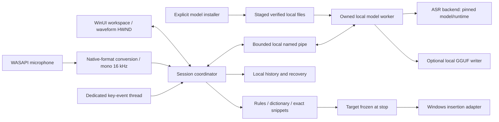

# Proposed Windows architecture

> Planning/release-contract snapshot. See [Phase 1 execution and current evidence](PHASE-1-STATUS.md) for the implemented preview and the tests actually run.

Status: design proposal, not implemented. Evidence IDs refer to the [validated research](../research/30-final-report.md). C# / WinUI 3 is the proposed native shell; no web runtime is required for the UI.

## Process and module layout

The shell owns session state, UI, integration coordination and the worker Job Object. A separate model worker isolates native inference failures from the UI and can be terminated if cancellation/unload hangs. It has no clipboard or global keyboard responsibility. A bounded target-inspection helper is added if UIA provider-hang testing shows an in-process isolated thread cannot recover safely; Task cancellation alone does not abort a blocked COM provider call.

Proposed projects:

| Project | Responsibility |
| --- | --- |
| `FarFlow.Windows` | WinUI navigation, pages, view models, theme resources, setup and accessible status |
| `FarFlow.Core` | Platform-neutral state machine, rules, dictionary/snippets, edit validation, retention and portable schema |
| `FarFlow.WindowsIntegration` | WASAPI, keyboard edge events, HWND/DPI, UIA inspection, delivery, clipboard and GSMTC |
| `FarFlow.ModelHost` | Local ASR/writer adapters and versioned IPC; no server socket |
| `FarFlow.Infrastructure` | SQLite, model manifests/downloads, backup/import and diagnostics |
| Test/benchmark projects | Core fixtures, Windows adapter contracts, model benchmarks and live app matrix |

Actual app scaffolding waits for the Windows toolchain/launch gate. The .NET runtime, Windows App SDK and native model DLLs are pinned separately; one package version never proves that the entire runtime graph is compatible.

## Session coordinator

States: `Unavailable → Ready → StartingCapture → Recording → Transcribing → Cleaning → Delivering → Ready`, with explicit `Canceling`, recoverable `Faulted` and terminal `ShuttingDown` paths. Each recording has a new generation/session ID. Old buffers, IPC responses and media callbacks cannot affect a newer session. Duplicate starts do not create multiple microphone streams or taps. Inference never runs on the UI or hook callback thread.

At the initial key-down, request capture immediately; a roughly 220 ms hold threshold classifies release behavior rather than delaying the start. A short release may wait for a second tap within the configured double-tap window, initially approximately 350 ms. Use the Windows event timestamp with wrap-safe deltas; exact-boundary, repeated-down and delayed-delivery tests are required. The final chosen key is detected in setup. F8 is a product default proposal; its conflicts and laptop Fn-lock behavior must be handled through rebinding. [F2.1–F2.3, F4.3]

Reset the gesture and stop capture on cancellation, device loss, session lock, suspend and shutdown. A lost key-up must never leave indefinite capture. The persistent ready dot is distinguishable from microphone-on state.

## Audio contract

Use WASAPI shared-mode microphone capture, not output loopback. Enumerate stable endpoint identities, support System default, query `GetMixFormat`, negotiate/check support and normalize actual PCM/float samples and channels to the recognizer's contract. Do not copy the Mac assumption that a single cached 44.1/48 kHz format remains valid. Test 8/16/24/32/44.1/48/96 kHz inputs as applicable, stereo/multichannel downmix, silence flags, discontinuities and short packets. [F2.4–F2.5]

Use a tested explicit converter or negotiated engine conversion; WASAPI engine-side conversion exists, so application-side resampling is a design choice. One capture generation has one declared format. Rebuild converters at route changes; do not reinterpret old-rate data using a new rate. Preserve bounded captured speech for recovery when possible, with a visible outcome if recovery cannot be completed. No default audio-file persistence.

Warm model sessions without keeping the microphone stream open. Show Recording only after actual capture startup succeeds. Cache/unload behavior follows memory policy; a Bluetooth mode switch must not be treated as harmless without testing. The start/end earcons are new original short audio assets at subtle app-controlled gain, not copied Apple system sounds and not a system-volume change.

## Inference and text contract

ASR backend interface accepts finite mono Float32 audio plus sample rate, language preference, session ID and cancellation. It returns raw transcript, optional credible language metadata, timing and effective backend/provider diagnostics. Backend-specific minimum input/padding and preprocessing are explicit model metadata; do not assume the Mac Core ML minimum or copy a generic 80-bin mel default into a 128-feature Parakeet export. [F1.3]

Standard Light cleanup never loads the writer. Port dictionary boundaries, whole-trigger snippets, limited corrections and protected-span rules as golden test cases. Review .NET culture/normalization behavior rather than translating ICU regex syntax and assuming identical results. Apple NaturalLanguage has to be replaced. Prefer reliable model language metadata where available, otherwise evaluate a small separately licensed local language-ID adapter. Mixed/short text must not be forced into a false monolingual classification; when uncertain, apply only safe global/bilingual rules and honor explicit English/Dutch selection. [F4.5]

For AI edits, retain the original and reject changes that fail protected number/name/address/identifier/negation or language checks. These checks do not prove arbitrary semantic equivalence. Selected-text transforms always require preview and target/selection revalidation before replacement; undo is offered only when the inserted span can still be identified. No model output is executed as a command.

The writer adapter pins exact checkpoint, quantization, tokenizer/chat template, stop rules, context and output budget. Instruct-2507 and original hybrid-thinking Qwen3 are different configurations and checkpoints. A current community GGUF can be evaluated with explicit provenance; its existence does not make it an official Qwen-owned conversion. [F1.9 correction]

## Cursor delivery

Inspect the start context to reject known password/protected targets. **Freeze the intended destination at recording release/stop**, matching the Mac behavior that permits moving the cursor while speaking. Snapshot process/window identity, current focus and caret/selection where exposed. Recheck immediately before delivery and abort to recovery if the target changed or cannot be trusted. [F2.6–F2.8, F4.7]

UIA supports target discovery/readback; `ValuePattern.SetValue` is not generic caret insertion, and TextPattern itself is read-only. Do not read and rewrite an entire document as an append workaround. Prefer tested Unicode input for supported controls; use deliberate clipboard paste only for tested compatibility cases. Do not send Ctrl+V indiscriminately into every editor or retry after a partial/ambiguous injection.

Delivery outcomes are separate: `Verified inserted`, `Delivery requested—check field`, `Copy required`, `Blocked protected target`, `Target changed`, `Canceled`. A SendInput return count is not destination-content verification. Same-as-user integrity is the baseline; do not escalate the entire app or enable UIAccess as a general workaround. For known terminals, multiline content is review/copy-only and no Enter is appended; pasted newlines can themselves execute commands.

If clipboard fallback is used, snapshot only supported formats, acquire/release clipboard ownership correctly, set exclusion from Windows history/cloud sync for temporary content, and restore only if the sequence/ownership still belongs to Far Flow under the clipboard lock. A later user copy always wins. This does not prevent another clipboard-reading application from seeing temporary text. Unknown/delayed/private formats may require declining automatic clipboard substitution rather than claiming lossless restoration.

## Overlay and media

A separate waveform HWND uses nonactivating/tool-window behavior plus nonactivating show/position calls. Handle `WM_MOUSEACTIVATE` to avoid the documented hover-activation path when active-window tracking is enabled. Clicking/dragging the bar must not move the caret in the user's editor. Persist monitor-aware DIP placement, process `WM_DPICHANGED`, and clamp to the current work area after monitor/taskbar changes. Provide accessible equivalent actions in the main window/tray/keyboard; the tiny waveform remains words-free. [F2.9 corrected]

GSMTC controls cooperating media sessions only. Capture the exact session instance, source app, prior playing state, successful explicit pause and recording generation. Resume only that same still-valid session under the tested ownership policy; abandon resume if user/session intervention makes ownership uncertain. A Boolean pause result is not a causal ownership token. Never toggle a global media key or resume whichever player becomes current. Test capability behavior in the actual signed package. [F2.10–F2.11]

## Lifetime and IPC

Launch the model worker with creation-time Job Object assignment (`PROC_THREAD_ATTRIBUTE_JOB_LIST`), restrictive explicit handle inheritance and a sole noninherited owner handle. Do not leave a spawn-before-assignment orphan window. On close, stop hooks/capture, cancel delivery, resume any still-owned media pause, close overlay/tray, request graceful worker shutdown, then close/terminate the owned job after a bounded timeout. Minimize keeps the app available; forced UI exit must leave no model worker. [F2.12 corrected]

Use versioned, size-bounded local named-pipe messages scoped to the current user/session, with a per-launch random name/nonce and explicit session IDs. No transcript text in process arguments or default logs. Do not expose a loopback HTTP inference server. Pipe access controls and process separation do not create a malicious-model sandbox; approved artifacts and safe loading remain required.

## Storage, migration and deployment

Use SQLite transactions for local metadata/history and a path service that follows the chosen package data model. For MSIX, resolve the package LocalState/LocalCache locations rather than hard-coding a publisher-hash path; for an unpackaged alternative, use a dedicated per-user Far Flow Windows root. Models are outside the signed executable directory. Test update, uninstall and retain/remove-data behavior explicitly.

The canonical portable import is a reviewed **full UserData JSON backup** with ISO 8601 dates and schema 1, not a live SQLite copy or the separate dictionary-only export. Reset microphone/shortcut coordinates and quarantine Mac bundle-ID app styles for Windows reassignment. Add schema/golden fixtures with invented data. [F4.4 corrected, F4.6]

See [privacy](PRIVACY-AND-SECURITY.md), [model policy](COMPATIBILITY-AND-MODELS.md), and [release gates](VALIDATION-AND-RELEASE.md).
